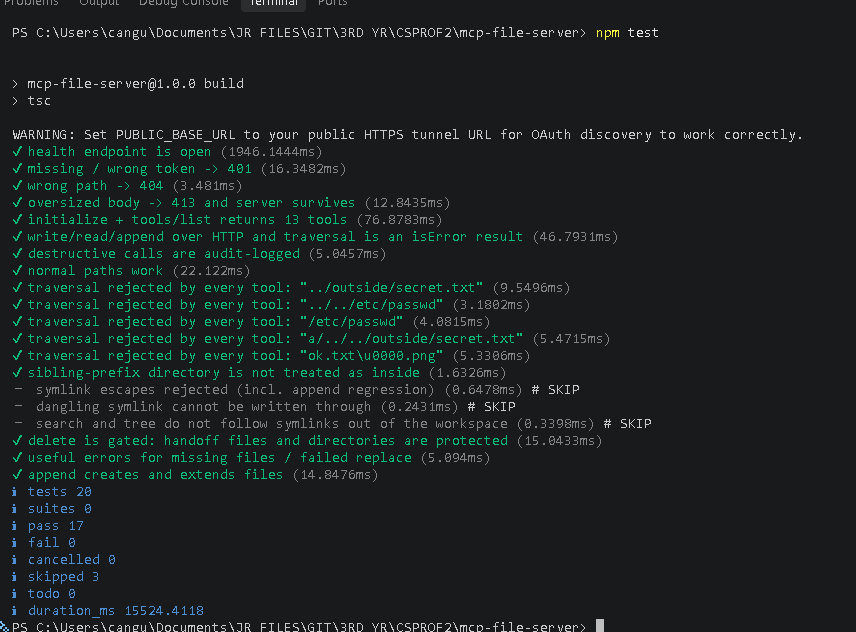
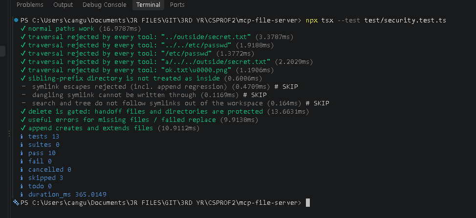
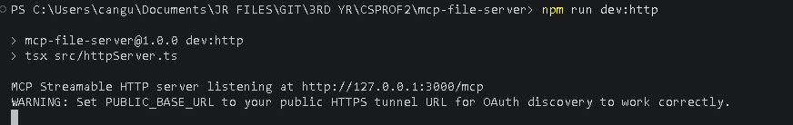

# MCP File Server

A custom Model Context Protocol (MCP) file server that provides controlled file operations inside a sandboxed workspace.

The server supports local MCP connections through **stdio** and remote MCP connections through **Streamable HTTP**. It provides 14 dedicated tools for file operations while restricting requested paths to the configured workspace.

## Project Overview

This project was developed as part of the CS3A / CS3B Elective MCP project requirements.

### Technology Stack

- Node.js 20 or later
- TypeScript
- Official MCP TypeScript SDK (`@modelcontextprotocol/server`)
- Zod for runtime input validation
- HTTP and Streamable HTTP transport
- PM2 for process management
- Cloudflare Tunnel for HTTPS exposure
- Git and GitHub for version control

Check `package.json` for the exact dependency versions and available scripts.

## Features

- Sandboxed workspace for file operations
- Workspace path validation and symbolic-link checks
- 14 single-purpose MCP tools
- Stdio transport for local MCP clients
- Streamable HTTP transport at `/mcp`
- Bearer-token authentication for HTTP requests
- OAuth authorization-code flow with PKCE for supported remote clients
- HTTP request-body limit of 1 MB
- TypeScript type checking
- Audit logging for mutating operations
- Project-state and handoff documentation
- Automated tests for file operations, security controls, and HTTP behavior
- PM2 process configuration and HTTPS tunnel deployment instructions

## Available MCP Tools

| Tool | Description |
|---|---|
| `workspace_info` | Returns information about the configured workspace. |
| `list` | Lists files and directories. |
| `read` | Reads a file. |
| `write` | Creates or overwrites a file. |
| `append` | Appends content to a file. |
| `str_replace` | Replaces specified text in a file. |
| `delete` | Deletes a file, subject to safeguards. |
| `search` | Searches workspace files for text. |
| `move` | Moves or renames a supported item. |
| `mkdir` | Creates a directory. |
| `file_info` | Returns information about a file or directory. |
| `copy` | Copies a supported item. |
| `tree` | Displays the workspace directory structure. |
| `delete_folder` | Recursively deletes an existing directory and its contents|
File operations are intended to remain inside the configured workspace. Paths that attempt to escape the workspace are rejected by the path-security checks.

## Requirements

Install the following before running the project:

- Node.js 20 or later
- npm
- Git

PM2 and Cloudflare Tunnel are additionally required for the documented deployment workflow.

## Installation

Clone the repository:

```powershell
git clone https://github.com/dmhndsm/CS2_MCP-FILE-SERVER.git
```

Enter the project directory:

```powershell
cd CS2_MCP-FILE-SERVER
```

Install dependencies:

```powershell
npm install
```

## Running the Server

### Stdio Transport

Start the local MCP server:

```powershell
npm run dev
```

This runs the TypeScript server through `tsx` and uses stdio for communication with a compatible MCP client.

### Streamable HTTP Transport

The HTTP server requires `MCP_AUTH_TOKEN`. The token must contain at least 32 characters.

In PowerShell, configure a token for local testing:

```powershell
$env:MCP_AUTH_TOKEN = "REPLACE-WITH-A-STRONG-RANDOM-SECRET-AT-LEAST-32-CHARACTERS"
```

Start the HTTP server:

```powershell
npm run dev:http
```

By default, the server listens at:

```text
http://127.0.0.1:3000/mcp
```

The default host is `127.0.0.1`, and the default port is `3000`. The `HOST` and `PORT` environment variables can override these values.

HTTP requests must include the bearer token:

```http
Authorization: Bearer YOUR_MCP_AUTH_TOKEN
```

Requests without the correct token should receive `401 Unauthorized`.

**Security:** The example token is a placeholder. Generate a strong random secret for actual use. Do not commit real tokens to Git. Remote access requires an appropriately secured HTTPS endpoint and suitable deployment configuration.

## Configuration

| Variable | Purpose | Default |
|---|---|---|
| `MCP_AUTH_TOKEN` | Required bearer token for HTTP transport; at least 32 characters | No default |
| `HOST` | HTTP listening interface | `127.0.0.1` |
| `PORT` | HTTP listening port | `3000` |
| `WORKSPACE_ROOT` | Optional workspace directory override | Determined by the server's path-resolution logic |
| `MCP_OAUTH_PASSWORD` | Password protecting the browser authorization flow when OAuth is enabled | No default |
| `PUBLIC_BASE_URL` | Public HTTPS origin used for OAuth metadata and redirects | No default |

Set environment variables in the same terminal session used to start the server.

`PUBLIC_BASE_URL` must contain the public HTTPS origin only, without the `/mcp` suffix. Update it whenever the tunnel URL changes.

Never commit actual credentials or secrets.

## Claude Web Remote Connector (OAuth)

The HTTP server supports an OAuth authorization-code flow with PKCE for supported remote MCP clients.

Before starting the HTTP server, configure the required variables in PowerShell:

```powershell
$env:MCP_AUTH_TOKEN = "YOUR-STRONG-BEARER-TOKEN-AT-LEAST-32-CHARACTERS"
$env:MCP_OAUTH_PASSWORD = "YOUR-SEPARATE-STRONG-OAUTH-PASSWORD"
$env:PUBLIC_BASE_URL = "https://YOUR-CURRENT-TUNNEL.trycloudflare.com"

npm run dev:http
```

Use separate secrets for `MCP_AUTH_TOKEN` and `MCP_OAUTH_PASSWORD`. Do not put actual secrets in this README, screenshots, source control, or public messages.

In a compatible remote MCP client, configure a custom connector using the current public MCP URL:

```text
https://YOUR-CURRENT-TUNNEL.trycloudflare.com/mcp
```

Replace the example URL with your actual tunnel URL. Follow the client's authorization workflow when connecting.

The OAuth implementation includes authorization-server and protected-resource metadata, dynamic client registration, authorization codes with PKCE S256, token exchange, and refresh-token support, according to the project implementation.

**OAuth limitation:** OAuth clients, authorization codes, sessions, and tokens are held in memory in the current implementation. Restarting the server invalidates in-memory state, so a remote client may need to reconnect. This implementation is intended for a single-user academic project. Before production use, consider durable state storage, rate limiting, session revocation, and stronger operational monitoring.

## Deployment: HTTPS and PM2

See the [Deployment Guide](docs/DEPLOYMENT.md) for detailed installation, configuration, tunnel setup, authentication checks, and process-recovery instructions.

The deployment workflow includes building the project, starting the PM2 process, and exposing the local HTTP service through a configured HTTPS tunnel.

Build the project:

```powershell
npm run build
```

Start the configured process:

```powershell
pm2 start ecosystem.config.cjs --update-env
```

Open a Cloudflare Quick Tunnel:

```powershell
cloudflared tunnel --url http://127.0.0.1:3000
```

Use the actual public HTTPS URL printed by Cloudflare Tunnel. The MCP endpoint is that URL followed by `/mcp`.

Quick Tunnel URLs may change after a restart. Do not assume a temporary URL is permanent.

### Health Endpoint

The `GET /health` endpoint is intended for liveness checks and does not require authentication.

For example:

```powershell
Invoke-WebRequest http://127.0.0.1:3000/health
```

The expected response body is:

```json
{"status":"ok"}
```

### Audit Logging

Mutating operations are recorded in a JSON-lines audit log according to the current implementation. The location can be overridden with `AUDIT_LOG`, and logging can be disabled with `AUDIT_LOG=off`.

The `delete` tool is intended to delete files and refuses the four handoff files. The `delete_folder` tool is intended to recursively remove an existing directory and its contents. Because folder deletion is destructive, verify its implementation and safeguards before use, test it only with disposable folders first, and do not use it on important data until its behavior has been verified.

## Testing and Type Checking

Run the automated test suite:

```powershell
npm test
```

Run the TypeScript check:

```powershell
npm run typecheck
```

Alternatively, run:

```powershell
npx tsc --noEmit
```

A successful TypeScript check completes without TypeScript errors.

### Recorded Automated Test Results

The documented full test run produced the following results:

| Result | Count |
|---|---:|
| Total tests | 20 |
| Passed | 17 |
| Failed | 0 |
| Skipped | 3 |



The security-only test run produced the following results:

| Result | Count |
|---|---:|
| Total tests | 13 |
| Passed | 10 |
| Failed | 0 |
| Skipped | 3 |



These figures describe the recorded test runs. Re-run the tests against the current commit before presenting them as results from a newer version.

### Security Test Coverage

The executed security tests include checks related to:

- Workspace path containment
- Path traversal rejection
- Protected handoff files and destructive-operation safeguards
- Error handling
- HTTP authentication and request handling

Three symlink-related tests were skipped in the recorded runs. Those cases have not been verified by these test results and should not be described as passing.

The project also includes an HTTP test suite. Review the test output and current implementation before claiming that every endpoint, response code, or security scenario has been verified.

## Verification Evidence

The following screenshots provide supporting evidence for the documented development checks.

### MCP Server Initialization

An authenticated initialization request returned HTTP 200 OK and an MCP initialization response.



This confirms the recorded initialization request succeeded. It does not independently prove that all tools or every deployment configuration works.

### Automated Tool Tests

The full test suite completed with 17 passing tests, 0 failing tests, and 3 skipped tests out of 20.


### Security Tests

The security-only suite completed with 10 passing tests, 0 failing tests, and 3 skipped tests out of 13.


Only use screenshots from the current project version. Before committing screenshots, remove or conceal passwords, authentication tokens, authorization codes, PKCE verifiers, session cookies, access tokens, and private workspace contents.

## Security Considerations

- File operations use workspace path validation.
- Paths that attempt to escape the workspace should be rejected.
- Symbolic-link checks are implemented, but the skipped tests leave some symlink-related scenarios unverified.
- Filesystem time-of-check-to-time-of-use (TOCTOU) races remain a residual risk.
- HTTP access requires bearer-token authentication; OAuth access tokens are handled separately by the OAuth implementation.
- HTTP request bodies are limited to 1 MB according to the implementation.
- Use HTTPS for remote connections.
- Do not expose the local development server directly to the public internet without appropriate security and deployment configuration.
- Use a dedicated workspace and avoid storing sensitive files inside it.
- Review destructive operations such as `delete` and `delete_folder` before production use.
- `delete_folder` should reject the workspace root and paths outside the workspace; verify symlink handling and filesystem race protections before exposing it to remote clients.
- Do not publish `MCP_AUTH_TOKEN`, `MCP_OAUTH_PASSWORD`, access tokens, authorization codes, session cookies, or PKCE verifiers.

For architecture details, security trade-offs, and known limitations, see the [Technical Report](docs/TECHNICAL_REPORT.md).

## Project Structure

The project follows this general structure:

```text
mcp-file-server/
├── src/
│   ├── server.ts
│   ├── httpServer.ts
│   ├── tools/
│   └── utils/
│       ├── pathSecurity.ts
│       └── auditLog.ts
├── test/
├── workspace/
│   ├── PROJECT_STATE.md
│   ├── PLAN_LOG.md
│   ├── CHECKPOINTS.md
│   └── DECISIONS.md
├── docs/
│   ├── DEPLOYMENT.md
│   ├── TECHNICAL_REPORT.md
│   └── images/
│       ├── server-running.png
│       ├── tool-tests.png
│       └── security-tests.png
├── ecosystem.config.cjs
├── manifest.json
├── package.json
├── package-lock.json
├── tsconfig.json
└── README.md
```

This is a representative structure. The actual repository may contain additional files or generated build output.

## Handoff Documentation

The project uses these files to record implementation state, progress, checkpoints, and technical decisions:

- `workspace/PROJECT_STATE.md`
- `workspace/PLAN_LOG.md`
- `workspace/CHECKPOINTS.md`
- `workspace/DECISIONS.md`

Keep these documents consistent with the current implementation. Update them when a feature is completed, a test result changes, or a new limitation is discovered.

## Development Status

### Implemented Features

According to the current project files and recorded development work, the project includes:

- MCP server with 14 tools (including `delete_folder`, pending build and safety-test verification)
- Workspace sandbox and path validation
- Stdio transport
- Streamable HTTP transport
- HTTP bearer-token authentication
- OAuth authorization-code flow with PKCE
- HTTP request-body size limit
- PM2 configuration
- Audit logging
- Automated tests
- Deployment and technical documentation

### Remaining Verification

The following items should be treated as outstanding until their results have been confirmed:

- Investigate and run the three skipped symlink-related tests.
- Re-run the complete test suite against the final commit.
- Verify any additional security scenarios required for the final submission.
- Verify PM2 restart behavior if it has not already been tested.
- Confirm that the README and deployment instructions reproduce the current setup from a clean installation.
- Verify a real MCP client workflow if required by the applicable course deliverables.

The documented initialization request and automated test results provide evidence of progress, but do not establish that every tool, deployment configuration, or security scenario has been verified.

## GitHub Repository

[CS2_MCP-FILE-SERVER](https://github.com/dmhndsm/CS2_MCP-FILE-SERVER)

Verify the current repository visibility in GitHub settings before sharing the repository link.

## License

This project is provided for academic and educational purposes. Check the repository for a formal license file before reusing or redistributing the code.